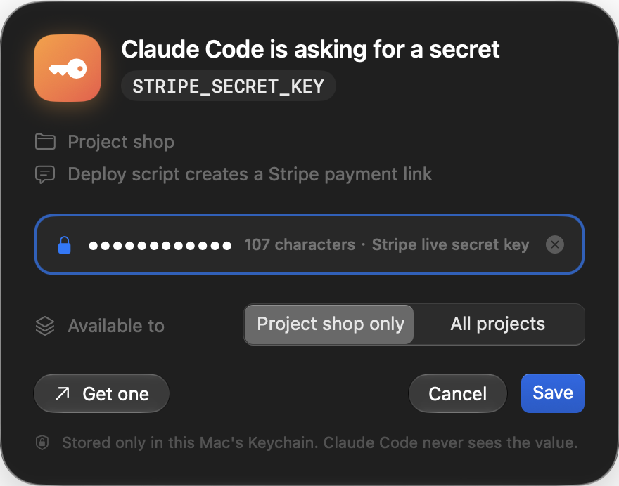

# tongs

**Let AI coding agents use your API keys without ever seeing them.**

[中文说明](README.zh-CN.md)

Coding agents (Claude Code, Codex, …) constantly need credentials: a GitHub token, a Stripe key, a database password. The usual options are pasting the key into the chat or leaving it in a plaintext `.env`. Either way it ends up in the agent's transcript, which is re-sent to the model provider on every turn and kept on disk.

tongs keeps secrets in the macOS Keychain and lets an agent use them **by name**:

```console
$ tongs request STRIPE_SECRET_KEY --why "deploy script creates a payment link"
stored shop/STRIPE_SECRET_KEY (project shop, 107 chars). Use it with: tongs run STRIPE_SECRET_KEY -- <command>

$ tongs run STRIPE_SECRET_KEY -- sh -c 'curl -sv https://api.stripe.com/v1/balance -u "$STRIPE_SECRET_KEY:"'
> Authorization: Basic ‹redacted:STRIPE_SECRET_KEY›…
```

- **Ask, don't paste.** `tongs request` opens a native panel; the human pastes the key there and the agent only learns that it was stored.
- **Inject, then scrub.** `tongs run` puts the value in the child's environment and redacts it, plus its Base64 and URL-encoded forms, from stdout and stderr.
- **Approve with Touch ID.** The first time an agent uses a secret in a project, you confirm with Touch ID. The approval lasts 12 hours.
- **Guard the side doors.** A PreToolUse hook for Claude Code and Codex blocks agents from reading the Keychain directly.
- **Nothing resident.** There is no daemon and no menu bar app. Every prompt is raised by the CLI call that needs it.

<p align="center"></p>

## Requirements

macOS 15 or later. The request panel uses Liquid Glass on macOS 26+ and system materials on 15.

## Install

From source (Swift 6.2 toolchain / Xcode 26):

```bash
git clone https://github.com/<you>/tongs && cd tongs
swift build -c release
ln -sf "$PWD/.build/release/tongs" ~/.local/bin/tongs
tongs doctor
```

Wire it into your agents. Without `--apply` this only prints what would change; with it, each modified file keeps a one-time `.tongs-backup`.

```bash
tongs setup claude --apply   # PreToolUse guard hook + ~/.claude/skills/tongs
tongs setup codex --apply    # ~/.codex/hooks.json + AGENTS.md block + ~/.codex/rules/tongs.rules
```

`tongs setup claude|codex --remove --apply` undoes it. Your stored secrets are left alone.

## Commands

| Command | What it does |
|---|---|
| `tongs ls [--all] [--json]` | Secrets usable here: names, scope, description. Never values, never a prompt |
| `tongs run NAME... -- CMD` | Run `CMD` with each `NAME` as an environment variable; scrub its output |
| `tongs request NAME [--why T] [--url U] [--global]` | Ask the human for a secret in a native panel |
| `tongs add NAME [--desc T] [--global]` | Store a secret yourself (hidden prompt, or stdin) |
| `tongs rm NAME` | Delete a secret (Touch ID) |
| `tongs grants` / `tongs revoke [NAME] [--agent A]` | Show / drop approvals |
| `tongs log [-n N]` | Activity log: who used what, where, for which command (no values) |
| `tongs doctor` | Check Keychain, Touch ID and panel access from the current context |
| `tongs hook` | The PreToolUse guard (reads hook JSON on stdin) |

Your shell expands `$NAME` before tongs runs, so the value would be empty. When the command line itself needs the value, single-quote it: `tongs run GH_TOKEN -- sh -c 'curl -H "Authorization: Bearer $GH_TOKEN" …'`.

## Names and scopes

- Use environment-variable names, ideally the one the consuming tool documents (`STRIPE_SECRET_KEY`, `DATABASE_URL`, `GH_TOKEN`). Don't put the project in the name.
- A secret is either **global** (`NAME`) or belongs to a **project** (`<project>/NAME`). The project is the git repository's directory name. Linked worktrees count as their main repository, so agents working in worktrees share its secrets and approvals.
- `tongs run NAME` uses the project's `NAME` if there is one, otherwise the global one. The environment variable is always `NAME`.
- `tongs request` stores into the current project by default; `--global` is for credentials of your own accounts that every project shares. The panel lets the human change it either way.

## Agents and sandboxes

Agent sandboxes (Codex's Seatbelt profile, Claude Code's sandbox) block the Keychain, LocalAuthentication, WindowServer and local sockets, so tongs has to run outside them. `tongs setup codex` adds Codex rules: `ls` and `request` are allowed outright, and `run` is set to `prompt`, so Codex shows you the command before it runs unsandboxed. With Claude Code's sandbox enabled, add `tongs` to `sandbox.excludedCommands`.

This means `tongs run` is an approved way out of the sandbox for the command it wraps. Read [SECURITY.md](SECURITY.md) for exactly what tongs does and doesn't protect against.

## Development

```bash
swift test                                    # scrubbing, grant signing, naming, guard rules
TONGS_SERVICE=dev.tongs.test tongs …          # keep test data out of your real secrets
TONGS_UI_PREVIEW="filled,dark,snap=/tmp/p.png" tongs request DEMO --why preview
```

The UI follows your preferred language (Chinese or English); `TONGS_LANG=zh|en` overrides it. `TONGS_UI_PREVIEW` pre-fills the panel, forces `light`/`dark`, can force the macOS 15 look with `legacy`, and with `snap=` writes a capture of the panel and exits without taking focus. A process may capture its own windows without Screen Recording permission, but the capture can't see the desktop behind the glass.

Builds from source are ad-hoc signed and the signature changes with every build. The Keychain then treats the new binary as a different app and asks for your login password once per secret; choose **Always Allow**. A Developer ID–signed release won't have this problem.

## License

[Apache-2.0](LICENSE)
